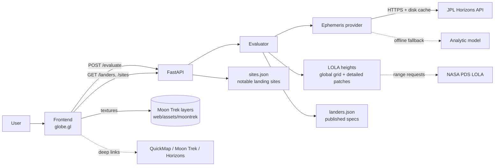

# Lunar Planner: Architecture

> Hackathon-sized. Two processes, one core endpoint.
> Items marked **(assumed)** are my picks where your description didn't say. Change them freely.

## Overview

The user picks a site, either by clicking anywhere on a 3D Moon, choosing a notable landing site (Apollo, Luna, Chang'e, past and planned CLPS) or typing coordinates. They then pick a real CLPS lander and a landing date and get a pass/fail verdict for that mission. Every site the user adds shows up in a comparison list they can swap between.

The browser owns the UI and the session state (the list of sites). The backend owns all the physics and data. Nothing is stored server-side, apart from a disk cache of Horizons responses.

It is built on the three NASA tools the challenge recommends:

| Tool | How we use it |
|---|---|
| **JPL Horizons** | The source of truth for Sun and Earth azimuth/elevation from any lunar surface point, given the site's LOLA elevation as its altitude. Also gives the sub-solar and sub-Earth points that light the globe (`api/ephemeris.py`). |
| **LRO LOLA (NASA PDS)** | Real elevation at two levels: the global LDEM_128 grid (~237 m) for every click, and ~30 m data fetched on demand around a site (`api/lola.py`). Drives site elevation and slope, the 3D terrain, and the terrain skyline that blocks the Sun and Earth. This is the same LOLA data Moon Trek and QuickMap display. |
| **Moon Trek** | Global map layers (WAC imagery, LOLA elevation, LOLA slope, Diviner max temperature), stitched from its WMTS tiles into globe textures (`scripts/fetch_moontrek_layers.py`), plus a deep link per site. |
| **QuickMap** | A deep link per site that opens LROC QuickMap zoomed to it, for high-resolution imagery and its visibility tools. |



## User flow → system mapping

| Step | UI | Backend call |
|---|---|---|
| 1. Click a spot, pick a notable site, or type lat/lon | Pop-up: Sun/Earth now and time to sunset/Earthset, sky chart, % sunlight, % Earth visible, slope, elevation, temp range, links to QuickMap / Moon Trek / Horizons | `GET /sites` (loaded once), `POST /evaluate` (site only) |
| 2. Pick lander and payload | Dropdown plus fact sheet | `GET /landers` (loaded once) |
| 3. Pick landing date | Timeline showing only valid windows, plus estimated launch date | `POST /evaluate` (site + lander) |
| 4. Summary | Pass/fail with each check explained, dates, sources | `POST /evaluate` (full) |
| 5. Lander at the site | 3D model on the globe at the site's lat/lon | None (frontend only) |
| 6. Comparison | Scorecard plus clickable list of sites | None (cached results) |

The comparison view is just the frontend's list of cached `/evaluate` results. It works from any step because it never needs the backend.

## Components

### Frontend (`web/`)
- **Stack:** plain HTML + JS, `globe.gl` from a CDN, no build step. Chart.js or hand-rolled SVG for charts **(assumed)**.
- **Globe:** Moon texture via `globeImageUrl`, switchable between the Moon Trek layers in `web/assets/moontrek/layers.json`, plus a bump map for relief on the imagery layer. Notable landing sites render as `labelsData` (gold = landed, cyan = planned). User sites render as `pointsData`. Any lat/lon is selectable via `onGlobeClick` or the coordinate form.
- **Deep links (`web/links.js`):** QuickMap (`prjExtent` in meters; `proj=16` equidistant cylindrical below ±75°, `27`/`26` south/north polar stereographic), Moon Trek (`#x=lon&y=lat&z=zoom`), and the raw Horizons az/el table for the Sun and Earth. All three projections were checked by opening a generated link and reading QuickMap's cursor coordinates.
- **Lander model (step 5):** a rough placeholder built from three.js primitives (a box body, four cylinder legs, a flat panel), colored per lander. Placed at the site with `customLayerData`. No model files to source or license. Swap in real GLBs later if there's time.
- **Pop-up:** sky chart (Sun and Earth positions over the horizon), stat tiles, **Confirm** and **Add to comparison** buttons.
- **Timeline:** a horizontal strip. Valid windows are filled, invalid dates are not selectable.
- **Visualizations:**
  - Sunlight on the panel (W/m²) over the landing window, as a line chart.
  - Earth communications access over time at that site, as a strip or area chart.
- **Opening sequence:** an intro screen over a slowly turning close-up of the Moon (about a quarter in view); the title "Lunarcy" fades in, then "Press Enter to continue" (Enter or click). The landing page then appears over the same close-up. After a search (or "Skip"), the camera zooms out to the whole Moon over ~1.6 s and the menus fade in over 1 s. Site labels and Sun/Earth markers appear only after that.
- **Look:** menus are translucent (blurred) panels over a full-screen globe. The heatmap uses saturated yellow for "nearly meets". The 3D view has a baseline cool night light (ambient 0.55 plus earthshine) so the surface stays readable at night but obviously dark; daytime fill is 0.12.
- **Start screen:** after the intro, two choices: "Explore the Moon" (straight to the app) or "Plan a mission" (the landing page below, which has "← Back" and "Skip").
- **Landing page (site finder):** Mission goal ("Check for ice in deep craters", or "No specific goal" to skip the ice check; with a maximum distance to an ice candidate, default 50 km; the search area defaults to the south polar region), start/end dates, minimum daylight %, minimum Earth-in-view %, minimum *average* sunlight on a flat panel (W/m², nights included), maximum slope, search area. It calls `POST /find`, then shows the results in the Search tab and as a heatmap on the globe in three colours: light blue = meets everything and ice within range, green = meets everything without ice in range, yellow = marginal (within 85% of every threshold), darker = outside the search area. Each cell is drawn as a 9 km disc on the ground (an ellipse widened by 1/cos(lat) on the map), so areas are round and smooth at the poles and single cells still show; a white outline surrounds every suitable area. The top 10 terrain-checked regions get "#1"–"#10" labels (click to open): orange when within ice range (contrasts with the blue), white otherwise. Craters with published ice evidence or rated "likely" are labelled on the globe ("Show polar craters rated for ice"); clicking one opens its deepest floor point. The selected site is a hot-magenta pin with a pulsing ring; pins and labels scale with camera altitude (`zoomScale` in `web/app.js`) so they keep a constant on-screen size. The intro opens with the Earth on the left (`web/intro_earth.js`: its own small three.js canvas, NASA Blue Marble day and city-lights night textures from jsDelivr) and the Moon, shifted right and fully black, coming out of shadow as the light swings from behind it to the viewer; the title fades in on the same clock; titles use Cinzel / Cormorant Garamond from Google Fonts. Menus are frosted black/grey/white glass (colour only on data and status); the right panel opens after every mission search. The lander picker, landing windows and pass/fail verdict are no longer in the UI (the `/evaluate` lander fields still work in the API). Temperatures are shown in °C (the API still returns kelvin). Site stat tiles are filled from the left by a viability fraction (sunlight/Earth %, flatness, gentleness of the temperature swing, peak sunlight / 1,361 W/m²) in their rating colour. Any element with `data-tip` shows a frosted explanation tooltip on hover or focus: stat tiles, search results (why it qualifies and ranks there), the search summary (how the search works) and every site-plan row (why that spot, path, tower height or ice target). **Hover highlight:** hovering a site anywhere (globe label or pin, Sites list, search results, comparison headers) turns its globe label white and enlarges it. (A beam-into-space beacon existed briefly and was removed.) Sites opened from a search result show **Why this site was recommended** on the Site tab (the same reasoning as the result's tooltip). The globe shows N and S pole markers: a Cinzel letter in a home-plate-shaped badge whose point touches the pole (html layer; the badge is offset half its height because globe.gl centres markers on their point). Craters with published ice evidence or rated "likely" are labelled on the globe ("Show polar craters rated for ice"); clicking one opens its deepest floor point. "Skip" goes straight to free exploration. The last requirements are remembered in `localStorage`.
- **Right panel = tabs:** **Search** (requirements summary, ranked regions with colour-coded stats, "+ Compare"), **Site** (the selected site: terrain level, Sun/Earth status, stat tiles, 3D view, mission and verdict, sources), **Compare** (the comparison), **Sites** (notable sites + coordinates). The analysis period sits as a compact bar above the tabs and applies everywhere. A search sets it to the mission dates. The panel hides with the ▶/◀ arrow; the map-layer box and the legend collapse with their ▾ arrows. Collapsed state is remembered.
- **Compare tab:** a vertical table, so it fits the panel: rows are values (where, verdict, sunlight or daylight hours, Earth, average and peak panel sunlight, slope, elevation, lander, landing, terrain level), columns are sites. Cells are colour-coded. Click a site's name to open it; × removes it.
- **Stat colours:** site tiles and summaries are green/yellow/red (`rateStats()` in `web/app.js`), tied to the evaluator thresholds and the lander's limits. Green = passes with margin, yellow = close to the limit, red = fails or poor. Thresholds show on hover; the legend is bottom-left. Sunlight uses 18/6 h for a single day, 75/60% over a mission, 70/40% for a range under 25 days, and 45/30% for a month or more. Earth uses 95/80% (22.8/19.2 h for a day), slope 0.7×limit/limit, and peak panel sunlight 500/150 W/m². Temperature compares the Diviner day high with the lander's rated limit (an estimate; 400 K if none chosen): green ≤ limit − 30 K, yellow up to the limit. Elevation isn't rated.
- **3D site view (`web/site3d.js`, three.js 0.170 via the import map in `index.html`):** a 20 × 20 km terrain mesh from `/terrain/patch` (true 1× vertical scale, with the Moon's curvature applied), a directional light at the Sun's Horizons az/el with shadows, the Sun and Earth drawn 6× and 3× their true angular size so they're visible (said on screen), and Earth's phase from the Sun/Earth geometry. Also shown: the skyline from `/terrain/horizon` and N/E/S/W labels. A timelapse plays the `/evaluate` series from the landing hour to mission end (or across a lunar day if no landing is chosen), with play/pause, speed and a scrubber. The readout shows UTC time, T+, Sun and Earth az/el, sunlight on the panel (W/m²), comms, time to sunset/Earthset, and "behind terrain" when the skyline blocks the Sun or Earth. Moon and Earth surfaces are generic textures by design. Coordinates: x = east, y = up, z = −north, and direction = `(sin az·cos el, sin el, −cos az·cos el)`. `window.__lunar3d` exposes the live view for debugging. The view uses the site's terrain level (global: 257² vertices; detailed: 513²). Detailed terrain is fetched from the Site tab's button; the 3D view no longer has its own. Terrain beyond the 20 km patch still casts shadows through an invisible **skyline occluder**: a ring just outside the patch, as tall as the real skyline in each direction, that only casts shadows. It's exact at the landing site and approximate elsewhere.
- **Globe lighting:** a "Light by the real Sun" toggle (on by default) points globe.gl's directional light from the Horizons sub-solar point and shows Sun/Earth markers. The time used is the chosen landing time, or now. `window.__globe` exposes the globe for debugging.
- **State:** one array of sites in memory:

```js
{ id, lat, lng, lander, payload, landingDate, result /* last /evaluate response */ }
```

Remember that globe.gl uses `lng` and the API uses `lon`.

### Backend (`api/`)
- **Stack:** FastAPI + Uvicorn, Pydantic models. FastAPI also serves `web/` as static files, so one process, one port, no CORS **(recommended)**.
- **Endpoints:** `POST /find`, `POST /evaluate`, `GET /landers`, `GET /sites`, `POST /terrain/detail`, `GET /terrain/patch`, `GET /terrain/horizon`, `GET /sky/subpoints`, `GET /sky/subpoints/series`, `GET /site/dates`, `GET /site/nearby`, `GET /ice`, `GET /site/plan`, `GET /health`.
- **Elevation, two levels (`lola.py`).** Both levels are *height sources*: `heights(lat_deg, lon_deg) -> metres` above the 1737.4 km sphere (the same reference radius as Horizons), plus `source` and `resolution_m`.
  - **Global estimate:** `LolaGlobalHeights` memory-maps LOLA **LDEM_128** (128 px/deg, ~237 m, 2.1 GB; LDEM_64 also works), downloaded once by `scripts/fetch_lola.py`. Big data lives **outside the project**, in `~/LunarPlannerData/` (or `$LUNAR_DATA_DIR`, see `api/paths.py`), so it stays out of git and OneDrive. Instant for any point. If the file is missing, `main.GLOBAL_HEIGHTS` falls back to `patch.SyntheticHeights` (labelled PLACEHOLDER).
  - **Detailed (on demand):** `fetch_detail_patch()` builds a 30 × 30 km, 30 m local grid from NASA PDS using HTTP multi-range requests. Only the needed rows come down (a few MB out of 0.5–2 GB files), in 3–7 s, then it's cached in `~/LunarPlannerData/lola_detail/`. Below 76° latitude it uses LDEM_1024 cylindrical tiles (~30 m, crossing tile edges and the 0/360 seam). Above 76° it uses the LDEM_75S/75N_30M polar stereographic grids. `DetailedHeights` uses the patch within 15 km and the global grid beyond, so distant mountains still count.
  - Validation: LDEM_64 gave 2,602 m at IM-1, against NASA's published ~2,579 m. The polar and cylindrical detailed products agree (correlation 0.999, mean difference under 3 m). Detailed slope at IM-1 is 13.3° over 60 m; a published study of the landing site gives about 12°.
- **Local terrain (`patch.py`):** products built from a height source.
  - `GET /terrain/patch?lat&lon&size_km=20&n=256&level=global|detailed` → `{center_lat, center_lon, size_m, n, spacing_m, projection: "local-tangent", center_height_m, heights: [n·n, row-major, row 0 = north edge, col 0 = west edge, null = hole], source, level}`. Curvature is not removed (the client applies it).
  - `GET /terrain/horizon?lat&lon&radius_km=150&level=global|detailed` → `{azimuth_step_deg: 1, elevation_deg: [360 values, clockwise from north], radius_m, observer_height_m: 2, source, level}`. Calculated by marching 300 log-spaced samples out to the radius along each azimuth, including curvature. Takes about 0.2 s and is cached.
  - `POST /terrain/detail?lat&lon` → downloads (or reuses) the detailed patch: `{level, product, spacing_m, size_m, cached, seconds, source}`. Returns 502 with a message if NASA PDS can't be reached.
- **Sun & Earth on the globe:** `GET /sky/subpoints?time=ISO` (default now) → `{sub_solar: {lat, lon}, sub_earth: {lat, lon}, time, source}` from Horizons (`COMMAND='301'`, `CENTER='500@399'`, `QUANTITIES='14,15'`), cached per hour. The globe's directional light points from the sub-solar direction, so day and night are real. Sun and Earth markers float above both points (direction only, not to scale).
- **`evaluator.py`:** `evaluate(lat, lon, terrain=..., ephem=..., lander=..., ...) -> Result`. It does no I/O itself. The ephemeris provider is passed in, so tests use the offline one.
- **Ephemeris (`ephemeris.py`):** `HorizonsEphemeris` calls the JPL Horizons API (`CENTER='coord@301'`, `SITE_COORD='lon,lat,alt_km'` with the site's LOLA elevation (the "Horizons refinement"), `QUANTITIES='4'`) for the Sun (`10`) and Earth (`399`) in parallel, hourly. Responses are cached on disk in `data/horizons_cache/`. A first call for a new site takes about 1–2 s, and a cached call about 10 ms. If Horizons can't be reached, it falls back to `AnalyticEphemeris` and the response's `sources` says so. Set `EPHEMERIS=analytic` to force offline mode. Horizons uses the Moon's mean-Earth (ME) frame, the same frame as LOLA.
- **Notable sites (`data/sites.json`):** Apollo 11–17, Surveyor 1, Luna 9/16/17/21/24, Chang'e 3–6, Chandrayaan-3, SLIM, IM-1, Blue Ghost M1, IM-2, plus planned CLPS targets. Planned sites without published coordinates have `precision: "region"` and a `note`. Each entry cites a `source`.
- **Site stats (`terrain.py`):** elevation and slope come from the active height source. Slope is a central difference across one source pixel: ~470 m at the global level (LDEM_128), 60 m at the detailed level. Either way it's a terrain-scale slope, not a boulder-scale one. The temperature range is real: NASA LRO Diviner Global Cumulative Products (bolometric temperature averaged per 0.5° cell and per 0.25 h of local time). We keep the coldest and hottest bins (night low, day high), built once by `scripts/fetch_diviner.py` into `~/LunarPlannerData/diviner_tbol_minmax.npz` and bilinearly interpolated (cells without data are skipped). The placeholder grid from `scripts/build_grids.py` is only a fallback.
- **Landers:** `landers.json` holds published specs per CLPS lander: name, operator, mass, payload capacity, solar array area and efficiency, max slope, operating temperature range, transit time. Each entry has a `source` URL.

## Site finder (`api/finder.py`, `POST /find`)

Searches the whole Moon for regions that meet mission requirements, in two stages.

1. **Global screen (seconds).** One Horizons query (`COMMAND='301'`, `CENTER='500@399'`, `QUANTITIES='14,15,20'`) gives the sub-solar point, the sub-Earth point and Earth's distance at each step of the period (hourly; longer periods use a coarser step, at most 1,000 samples). For every cell of a 0.5° grid (259,200 cells, ~15 km), the elevations follow from vector maths: `sin(el_sun) = n·s`, and `sin(el_earth) = (n·E − R)/|E − R n|` (Earth parallax included). If `scripts/build_skylines.py` has been run, every cell has a precomputed LOLA terrain skyline (4° azimuth steps, 150 km radius, ~47 MB in `~/LunarPlannerData/`), and the Sun and Earth count only when above it. Per cell, it computes daylight %, Earth-in-view % and mean flat-panel sunlight (W/m²). Slope comes from the global LOLA grid.
2. **Regions + terrain check.** Cells meeting every requirement are grouped into connected regions (longitude wraps). Each region is ranked by its best cell's *weakest margin* above the requirements, then by area. The best cell of each top region (up to 25) gets a full 2° skyline (if it had none) and is re-scored; regions that fail once terrain is counted are flagged "fails with terrain".

Response: `{criteria, period, grid: {res_deg, nlat, nlon, lat0, lon0, classes_b64}, counts, regions: [{id, lat, lon, area_km2, cells, sun_pct, earth_pct, avg_w_m2, slope_deg, score, terrain_checked, passes_with_terrain}], terrain, sources, seconds}`. `classes_b64` is the grid as uint8 (row 0 = south, column 0 = 180°W): 3 = meets everything and is within `max_ice_km` of ice (ice goal only), 2 = meets everything, 1 = nearly (≥85% of each threshold), 0 = no, 255 = outside the search area.

**Mission goal "ice_craters"** (`goal`, `max_ice_km` in the request): suitable cells within `max_ice_km` of an ice target (a "likely" grid cell or the floor of a "known"/"likely" crater, see below) become class 3. Regions are grouped separately for class 3 and the remaining suitable cells, and ice-range regions rank first. Each region adds `ice_km`, `within_ice_range` and `nearest_ice_crater: {name, rating, distance_km}`; `counts` adds `ice_range_cells` and `ice_range_area_km2`; the response adds `criteria.goal`, `goal_label`, `max_ice_km` and an `ice` block (the same as `GET /ice`). Without a goal the response is unchanged (`ice: null`).

Check: the finder's numbers for a spot match a full `/evaluate` of the same spot (e.g. 570.1 vs 570 W/m², 99.2% vs 99% daylight).

Speed: ~9 s without skylines, 12–25 s with them. The skyline test only computes the Sun/Earth azimuth for samples between a cell's lowest and highest skyline point; the poles are slowest because the Sun is always near the horizon there. Limitation: 0.5° cells average away ~1 km features such as the near-permanently-lit polar ridges, so check candidate spots with the Site tab's detailed terrain.

## Site plan (`api/siteplan.py`, `GET /site/plan`)

`GET /site/plan?lat=&lon=&start=&end=&level=` (dates inclusive; default the next lunar day; the 3D view sends the analysis period, or a lunar day from its start if the period is under 14 days). Separate from `/evaluate`, so that contract is unchanged. Takes 1–3 s on the global grid.

- **Routing grid:** ±10 km around the site (the 3D view's patch) at half the terrain resolution (≥50 m), local east/north, curvature removed.
- **Drivable:** Dijkstra from the lander over 8-neighbour steps. Ground steeper than 15° in any direction can't be entered (driving across a steep hillside tips a rover even on a level step); NASA's VIPER page says it "can generally drive on slopes up to 15°". Steps cost their 3D length × (1 + 2·(slope/15°)²).
- **Solar array / comms hub:** reachable cells within 5 km with slope ≤10°, on a ~250 m lattice. Each gets a terrain skyline from a 10 m mast (4° coarse, then 1° for the best 8). The Sun/Earth directions are the site's own Horizons series (the same across a few km). Solar = most Sun-above-skyline hours, comms = most Earth hours, minus 0.3 %/km of drive from the lander.
- **Comms tower:** Earth-in-view % at the comms spot for towers of 2–500 m (`comms.tower.curve`). `ideal_m` = the lowest height within 1 point of the best; `realistic_m` = the best up to 20 m (an ESTIMATE of what a small lander could deploy); `beyond_concepts` when the ideal is over 200 m (the LUNARSABER tower concept: ~100 m, scalable to ~200 m).
- **Route:** cheapest drivable path solar ↔ comms (`drive_m`, `straight_m`, `max_slope_deg`).
- **Ice:** the nearest ice target from `api/ice.py`, named after the crater it lies in, with its `basis` (published evidence, or "ice could survive here, not a detection"). If within the patch, a drivable route goes to the reachable point nearest it, plus the remaining `gap_to_ice_m`.

Response: `{site, grid: {spacing_m, half_size_m, level, resolution_m, rough, reachable_km2}, solar: {lat, lon, east_m, north_m, elevation_m, sunlight_pct, slope_deg, drive_from_lander_m, mast_m, why: {candidates, lander_pct, refined}}, comms: {…, earth_pct, tower: {curve: [{height_m, earth_pct}], ideal_m, ideal_earth_pct, realistic_m, realistic_earth_pct, realistic_basis, beyond_concepts, reference}}, route: {points: [[east_m, north_m]…], latlon, drive_m, straight_m, max_slope_deg, same_spot?} | null, ice: {lat, lon, distance_km, distance_m, name, rating, basis, east_m, north_m, bearing_deg, in_view, route: {…, gap_to_ice_m} | null} | null, notes, sources, period, seconds}`.

3D view (no emojis): gold solar and violet comms masts (the comms label gives the realistic and ideal tower heights), a white tube for the route with its drive distance, a blue tube and dashed line toward the ice (or a dashed line and arrow to the patch edge when it's farther), and a "Site plan" panel (toggle "Site plan"). The globe shows the routes and a dashed great-circle line to the ice. On the global grid everything is labelled a rough estimate. The Site tab's "Get detailed terrain" button was removed; `POST /terrain/detail` and `level=detailed` still work through the API.

## Scenarios (`api/scenarios.py`): best dates and nearby alternatives

- **`GET /site/dates?lat=&lon=&start=&days=60&mission_days=14&priority=both|sun|comms`**: one hourly Horizons series for `days + mission_days` from `start`; every hour is a candidate touchdown, scored on the next `mission_days` (Sun above the LOLA skyline, Earth above it, both at once; cumulative sums). Touchdowns with the Sun hidden lose 5 points. Returns `daily` (each day's best hour: `date, time, sun_pct, earth_pct, both_pct, score, sun_up_at_touchdown, hours_to_sunset`) and `best` (top 5, at least 2 days apart).
- **`GET /site/nearby?lat=&lon=&start=&end=&radius_km=3`**: a 9×9 grid within ±radius. Each point gets the same skyline as `/evaluate` (`compute_skylines(..., az_step=1, samples=300, r0_m=30)` = `horizon_profile`) and the same interpolated visibility test against the site's Sun/Earth series, so the centre matches the site's tiles (checked: 20.4 % vs 20.3 %, 41.4 % vs 41.4 %). Returns the grids (`sun_pct`, `earth_pct`, `slope_deg`, `lat`, `lon`), `centre`, `spread`, and `best_sun` / `best_earth` / `best_both` (ground ≤10° only). ~1.5 s.

Frontend (Site tab): the **Sky & horizon** panel (`web/skycharts.js`, plain SVG) draws, from the `/evaluate` `sky` and `power_w` series plus `/terrain/horizon`: a 360° panorama of the LOLA skyline centred on Earth's mean azimuth with the Sun and Earth paths (solid when in view) and their positions at the slider time; Sun/Earth elevation over time with the terrain horizon in their direction (dashed); Sun / Earth / both in-view bars; flat-panel W/m². One time cursor (slider or drag on any chart), a readout with time to the next sunset/Earthset or rise, a **Full view** window (click the panorama or the button) that lays the same charts out as a dashboard grid (panorama + readout and legend, elevation + power + in-view), and a CSV download. Below it, **Best landing dates** (a day strip and the top 5; clicking one loads those dates) and **Nearby alternatives** (two 9×9 heat grids; click a square to open that spot). A **Sun elevation** tile (max and average while in view) joins the stats.

**Comparison columns are scenarios:** a site *and* its dates (`site.period`). "Add these dates to comparison" freezes the current dates; changing the Period bar while a column is open opens a copy, so columns keep their dates. "Use current dates for all" re-runs every column for the Period bar; "Export CSV" saves the table. The Period bar has −1 mo / −1 d / +1 d / +1 mo steps. **Share links:** `#lat=&lon=&from=&to=&name=` opens that site and dates directly (skipping the intro). **Modes:** the start screen offers Explore the Moon or Plan a mission (`setMode`; a "change mode" link under the panel title returns to it). The guided tour, the **Learn** tab and the whole "Learn by exploring" box (tour, Equator vs pole, time-lapse) are Explore-only (`.explore-only`, shown when `body.mode-explore`); switching to planning ends a tour, closes Equator vs pole and stops the time-lapse (back to the real Sun now). The Learn tab explains no atmosphere, the polar Sun, libration, polar ice, and why small changes matter. **Learning in explore mode** ("Learn by exploring" box on the globe, and the Learn tab): a 7-stop **guided tour** (near side → Apollo 11 → Shackleton rim → Shackleton floor → Chang'e 4 far side → Mare Smythii limb → your turn), each site stop flying in to a tilted, low-angle close-up (`tiltTo`: globe.gl's controls are switched off and the camera is driven directly, because they always pull their target back to the Moon's centre; `resetTilt()` hands control back before any normal fly-to and when the tour ends), opening the site with a beacon and a "Look:" hint pointing at the number or chart that shows the lesson; **Equator vs pole**: Apollo 11 and the Shackleton rim over the same month, side-by-side sky panels and computed facts (sunlight, Earth %, max Sun elevation, longest day and night, average W/m²), both added to Compare; and a **lunar-month time-lapse** of the globe's real-Sun lighting from `GET /sky/subpoints/series?start=&days=29.5&step_hours=6` (one Horizons query), with darker fill light so the terminator shows.

## Ice in deep craters (`api/ice.py`, `GET /ice`)

Surface water ice survives where the yearly maximum temperature stays below ~110 K (Paige et al. 2010): permanently shadowed polar crater floors. Built once on first use (~7 s) from data already on disk:

- **Permanent shadow (LOLA).** The Sun's declination relative to the lunar equator stays within ±1.54°, so at each latitude the highest the Sun can ever be at each azimuth is fixed (`max_sun_elevation`). A point is permanently shadowed when its skyline is above the Sun's top limb (+0.27°) at every azimuth. The grid uses the finder skylines for every cell poleward of 70°; each crater gets its own 1° skyline from its deepest floor point.
- **Cold traps (Diviner).** Cells whose measured maximum temperature is ≤110 K.
- **Named craters.** `api/data/polar_craters.json` from the USGS Gazetteer (IAU names, ≥75° latitude, ≥8 km; `scripts/fetch_polar_craters.py`). Per crater: depth = median rim height (0.7–1.3 R) minus the floor minimum (inside 0.6 R), floor shadow, coldest Diviner cell inside the crater. Published evidence for Cabeus (LCROSS, Colaprete 2010), Shackleton (Zuber 2012) and Haworth/Faustini/Shoemaker (LAMP, Hayne 2015) is stored with its citation.
- **Ratings:** known (published evidence) · likely (floor permanently shadowed *and* ≤110 K) · possible (one of the two) · unlikely. Grid classes: 2 = shadowed and cold, 1 = one of the two, 0 = no.

Response: `{grid: {res_deg, nlat, nlon, lat0, lon0, classes_b64}, counts, has_shadow_grid, has_temperature, ice_stable_k, craters: [{name, lat, lon, diameter_km, link, evidence?, floor_lat, floor_lon, depth_m, depth_to_diameter, floor_shadowed, shadow_margin_deg, coldest_tmax_k, rating}], sources}`.

Check: the coldest craters come out as the literature has them: Haworth 51 K, Shoemaker 65 K, Faustini 72 K, Hermite 86 K, Shackleton 91 K, Cabeus 108 K, all with permanently shadowed floors. Limits: the 0.5° cells and ~237 m LOLA grid miss sub-km cold traps; "possible" craters often have a small shadowed patch at the foot of the equator-facing wall in an otherwise warm cell; buried ice isn't seen.

## How the numbers are computed

| Output | Method |
|---|---|
| Sun/Earth azimuth and elevation over time | JPL Horizons apparent az/el from the site (altitude = LOLA elevation) |
| Terrain horizon (skyline) | `horizon_profile()` over the active LOLA level, out to 150 km, with curvature |
| Sun/Earth *visible* | Elevation above the skyline at that azimuth (`sun_visible`/`earth_visible` per step). Everything below uses this. |
| Time to sunset / Earthset | First horizon crossing in the series (`events`) |
| Hours of daylight / Earth in view | `visible_hours()`: hourly samples, with the rise/set moment inside an hour interpolated linearly (a 06:40 sunrise counts 0.33 h). `sun_hours` / `earth_hours` (+ `_flat`). |
| % time in sunlight | `sun_hours / period hours`. `sunlight_pct_flat` gives the smooth-horizon value for comparison. |
| Sunlight on the panel (shown in the UI) | `w_m2 = 1361 W/m² × sin(sun_elev)` on a flat panel, per m², before efficiency; zero in terrain shadow or below the horizon. |
| Solar watts (`w`, kept for compatibility) | `w_m2 × panel_area × efficiency` (the lander's, or 1 m² at 30%). |
| Earth visibility / comms access | Fraction of timesteps with Earth above the skyline (`earth_visible_pct_flat` for comparison). The far side correctly shows zero. |
| Sunrise/sunset, Earthrise/Earthset | First visibility change in the series, so a crater rim delays "sunrise". |
| Slope, elevation | LOLA height source (global or detailed), bilinear; slope over one pixel each side |
| Temp range | Diviner night low / day high, bilinear over 0.5° cells |
| Valid windows | Dates where all checks below pass over the mission duration |
| Estimated launch date | `landing_date - lander.transit_days` **(assumed)** |

Default time resolution is 1 hour over one lunar day (about 29.5 days). Use vectorized NumPy so a call takes well under a second.

## `/evaluate` contract

**Request**

```json
{
  "lat": -85.2,
  "lon": 31.0,
  "lander_id": "blue-ghost",
  "payload_kg": 90,
  "landing_date": "2027-03-14"
}
```

`lander_id`, `payload_kg`, `landing_date` and `landing_time` are optional. Omitting them returns the site-only stats from step 1. Omitting only the landing date/time also returns `windows` for step 3. `landing_time` (UTC, e.g. `"2027-03-14T07:00:00Z"`, rounded down to the hour) wins over `landing_date` (which means 00:00 UTC). With either one and a lander, the `sky`/`power_w`/`comms` series start at the landing hour and span the lander's mission, which is what the 3D timelapse plays.

| Field | Type | Rules |
|---|---|---|
| `lat` | float | -90 to 90 |
| `lon` | float | -180 to 180 |
| `lander_id` | string | Must exist in `landers.json` |
| `payload_kg` | float | 0 to the lander's capacity |
| `landing_date` | date | Must fall in the ephemeris range |
| `landing_time` | datetime (UTC) | Must fall in the ephemeris range |
| `period_start` / `period_end` | date (UTC, inclusive) | The analysis period. `period_start` alone = one 24 h day; with `period_end` = a range (max 366 days). Without them: the mission (if lander + landing) or the next lunar day. |
| `terrain_level` | `"global"` (default) or `"detailed"` | `"detailed"` downloads the ~30 m patch first if needed (a few seconds) |

**Response (200)**

```json
{
  "terrain": {
    "level": "global",
    "heights_source": "NASA LRO LOLA LDEM_128 global elevation (~237 m/pixel), PDS Geosciences Node",
    "resolution_m": 236.9,
    "site_elevation_m": -1850.0,
    "skyline_max_deg": 2.4,
    "detailed_cached": false
  },
  "period": { "kind": "day", "start": "2027-03-14T00:00Z", "end": "2027-03-15T00:00Z", "hours": 24 },
  "site": {
    "sun_hours": 18.8,
    "earth_hours": 14.6,
    "sun_hours_flat": 19.3,
    "earth_hours_flat": 14.6,
    "slope_deg": 4.2,
    "slope_baseline_m": 948,
    "sunlight_pct_flat": 80.1,
    "earth_visible_pct_flat": 61.0,
    "elevation_m": -1850,
    "temp_range_k": [95, 390],
    "sunlight_pct": 78.4,
    "earth_visible_pct": 61.0
  },
  "sky": [{ "t": "2027-03-14T00:00Z", "sun_el": 3.1, "sun_az": 91.2, "earth_el": 7.5, "earth_az": 12.0, "sun_visible": true, "earth_visible": true }],
  "events": { "sunrise": null, "sunset": "2027-03-27T05:00Z", "earthrise": null, "earthset": "2027-03-20T11:00Z" },
  "power_w": [{ "t": "2027-03-14T00:00Z", "w": 142.0, "w_m2": 73.6 }],
  "comms": [{ "t": "2027-03-14T00:00Z", "visible": true }],
  "windows": [{ "start": "2027-03-10", "end": "2027-03-22", "start_time": "2027-03-10T07:00Z", "end_time": "2027-03-22T18:00Z" }],
  "launch_estimate": "2027-03-08",
  "checks": [
    { "name": "slope", "pass": true,  "detail": "4.2° is under Blue Ghost's 10° limit" },
    { "name": "temperature", "pass": true, "detail": "Within the lander's rated range" },
    { "name": "sunlight", "pass": true,  "detail": "78% sun over the mission window" },
    { "name": "comms", "pass": false, "detail": "Earth visible only 61% of the time" },
    { "name": "payload", "pass": true,  "detail": "90 kg of 150 kg capacity" }
  ],
  "pass": false,
  "sources": ["LOLA DEM (NASA PDS)", "Diviner (NASA PDS)", "https://..."]
}
```

Each `check` carries its own plain-language `detail`, which is exactly what step 4 displays. Overall `pass` is true only if every check passes. In a site-only request (no `lander_id`), `checks` is empty and `pass`, `windows` and `launch_estimate` are `null`. With a lander but no date, `checks` holds only the date-independent checks (slope, temperature, payload). Windows are searched hour by hour: every hour is a candidate touchdown, and `start_time` (the first hour that passes) is the **suggested landing time**. The thresholds (for example, minimum sun % or Earth %) are config values in `evaluator.py` **(assumed)**.

## Data flow

1. The user clicks the globe, and the frontend calls `/evaluate` with `lat`/`lon` only.
2. The pop-up renders `site`, `sky`, `power_w` and `comms`.
3. On **Confirm**, the user picks a lander (from the cached `/landers`). The frontend re-calls `/evaluate` to get `windows` and `launch_estimate`, then draws the timeline.
4. The user picks a date, the frontend calls `/evaluate` once more for the full result, and step 4's summary renders from `checks`.
5. **Add to comparison** pushes the site and its latest result into the frontend array. Clicking a list row re-renders from that cached result.

## Errors

| Case | Code | Frontend behavior |
|---|---|---|
| Bad lat/lon, payload or date | 422 | Show the field message. Keep the pin. |
| Unknown lander | 404 | Refresh the lander list. |
| Terrain data missing at that point (grid hole) | 200 with `site` fields `null` | Show "No terrain data here". Sun and Earth stats still work, since they only need the ephemeris. |
| Anything else | 500 | "Evaluation failed, try again." Log the traceback. |

No auth, queues or retries.

## Decisions

| Decision | Choice | Why |
|---|---|---|
| Frontend build | None (CDN script tag) | Zero setup, fewer demo-day failures |
| Hosting | FastAPI serves static files | One process, no CORS |
| Number of endpoints | One core (`/evaluate`) | Same function answers every step; optional fields make it progressive |
| Comparison storage | Browser memory | No accounts, no database, instant swapping |
| Terrain data | LOLA at two levels: LDEM_128 on disk (outside the project), ~30 m on demand via HTTP range requests | Real NASA elevation everywhere instantly; detail only where it's asked for, without multi-GB downloads |
| Terrain-aware visibility | Skyline from LOLA applied to every Sun/Earth number | Crater floors and rims get correct sunlight and comms (e.g. Shackleton's floor: 0% sun vs 100% on a flat horizon) |
| Ephemeris | JPL Horizons API + disk cache, analytic fallback | Recommended by the challenge and our mentor. Authoritative, no kernels to install. Cache plus fallback keep demos working offline. |
| Map layers | Moon Trek WMTS tiles stitched once into local textures | Real NASA data with no runtime dependency on Trek |
| Site context | Deep links to QuickMap and Moon Trek | Their full analysis tools, one click away, without rebuilding them |

## Testing (minimum useful)

- **Unit:** a few `pytest` cases on the evaluator with known answers:
  - A south-pole rim point should have high sun %.
  - A far-side point should have about 0% Earth visibility.
  - Slope above the lander limit should fail the slope check.
- **API:** `TestClient` tests for site-only, full-request, bad-latitude (422) and `/health`.
- **Ephemeris:** Horizons parsing, cache and offline fallback, with no network needed. `RUN_LIVE=1 python -m pytest` also calls Horizons and checks that the Sun was about 10° up at Apollo 11's landing.
- **Sites:** every entry in `sites.json` has valid coordinates, a source, and a note if it's approximate.
- **Manual before every demo:** click a pole, the far side, the antimeridian, and add three sites to compare.

## Run it

```bash
python scripts/fetch_lola.py             # once: 2.1 GB LOLA global elevation (outside the project)
python scripts/fetch_diviner.py          # once: real Diviner temperature grids
python scripts/build_skylines.py         # once (~10-15 min): terrain skylines for the site finder
python scripts/fetch_moontrek_layers.py  # once (textures are also committed)
uvicorn api.main:app --reload
```

Then open `http://localhost:8000`.

## Out of scope (for now)

Partial Sun-disc shadowing (the Sun is treated as a point), temperature detail below 15 km (e.g. small permanently shadowed craters), boulder-scale slopes, trajectory and launch-vehicle modeling, saved sessions beyond share links, user accounts, real-time data.
