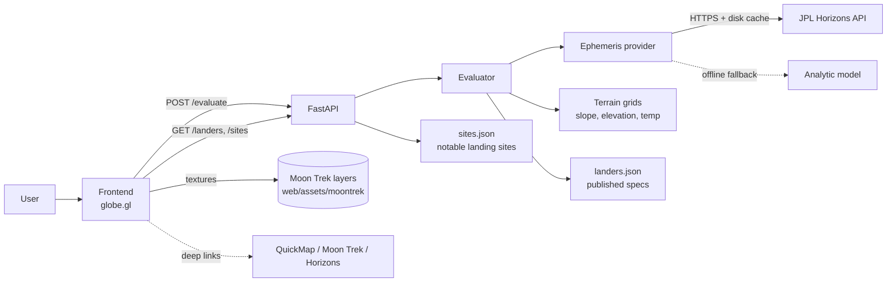

# Lunar Planner: Architecture

> Hackathon-sized. Two processes, one core endpoint.
> Items marked **(assumed)** are my picks where your description didn't say. Change them freely.

## Overview

The user picks a site, either by clicking anywhere on a 3D Moon, choosing a notable landing site (Apollo, Luna, Chang'e, past and planned CLPS) or typing coordinates. They then pick a real CLPS lander and a landing date and get a pass/fail verdict for that mission. Every site the user adds shows up in a comparison list they can swap between.

The browser owns the UI and the session state (the list of sites). The backend owns all the physics and data. Nothing is stored server-side, apart from a disk cache of Horizons responses.

It is built on the three NASA tools the challenge recommends:

| Tool | How we use it |
|---|---|
| **JPL Horizons** | The source of truth for Sun and Earth azimuth/elevation from any lunar surface point (`api/ephemeris.py`). |
| **Moon Trek** | Global map layers (WAC imagery, LOLA elevation, LOLA slope, Diviner max temperature), stitched from its WMTS tiles into globe textures (`scripts/fetch_moontrek_layers.py`), plus a deep link per site. |
| **QuickMap** | A deep link per site that opens LROC QuickMap zoomed to it, for high-resolution imagery and its visibility tools. |



## User flow → system mapping

| Step | UI | Backend call |
|---|---|---|
| 1. Click a spot, pick a notable site, or type lat/lon | Pop-up: Sun/Earth now and time to sunset/Earthset, sky chart, % sunlight, % Earth visible, slope, elevation, temp range, links to QuickMap / Moon Trek / Horizons | `GET /sites` (loaded once), `POST /evaluate` (site only) |
| 2. Pick lander and payload | Dropdown plus fact sheet | `GET /landers` (loaded once) |
| 3. Pick landing date | Timeline showing only valid windows, plus estimated launch date | `POST /evaluate` (site + lander) |
| 4. Summary | Pass/fail with each check explained, dates, sources | `POST /evaluate` (full) |
| 5. Lander at the site | 3D model on the globe at the site's lat/lon | None (frontend only) |
| 6. Comparison | Scorecard plus clickable list of sites | None (cached results) |

The comparison view is just the frontend's list of cached `/evaluate` results. It works from any step because it never needs the backend.

## Components

### Frontend (`web/`)
- **Stack:** plain HTML + JS, `globe.gl` from a CDN, no build step. Chart.js or hand-rolled SVG for charts **(assumed)**.
- **Globe:** Moon texture via `globeImageUrl`, switchable between the Moon Trek layers in `web/assets/moontrek/layers.json`, plus a bump map for relief on the imagery layer. Notable landing sites render as `labelsData` (gold = landed, cyan = planned). User sites render as `pointsData`. Any lat/lon is selectable via `onGlobeClick` or the coordinate form.
- **Deep links (`web/links.js`):** QuickMap (`prjExtent` in meters; `proj=16` equidistant cylindrical below ±75°, `27`/`26` south/north polar stereographic), Moon Trek (`#x=lon&y=lat&z=zoom`), and the raw Horizons az/el table for the Sun and Earth. All three projections were checked by opening a generated link and reading QuickMap's cursor coordinates.
- **Lander model (step 5):** a rough placeholder built from three.js primitives (a box body, four cylinder legs, a flat panel), colored per lander. Placed at the site with `customLayerData`. No model files to source or license. Swap in real GLBs later if there's time.
- **Pop-up:** sky chart (Sun and Earth positions over the horizon), stat tiles, **Confirm** and **Add to comparison** buttons.
- **Timeline:** a horizontal strip. Valid windows are filled, invalid dates are not selectable.
- **Visualizations:**
  - Solar power (watts) over the landing window, as a line chart.
  - Earth communications access over time at that site, as a strip or area chart.
- **Comparison list:** a sidebar. Clicking a row makes that site active and swaps the pop-up, charts and lander model to it.
- **State:** one array of sites in memory:

```js
{ id, lat, lng, lander, payload, landingDate, result /* last /evaluate response */ }
```

Remember that globe.gl uses `lng` and the API uses `lon`.

### Backend (`api/`)
- **Stack:** FastAPI + Uvicorn, Pydantic models. FastAPI also serves `web/` as static files, so one process, one port, no CORS **(recommended)**.
- **Endpoints:** `POST /evaluate`, `GET /landers`, `GET /sites`, `GET /health`.
- **`evaluator.py`:** `evaluate(lat, lon, terrain=..., ephem=..., lander=..., ...) -> Result`. It does no I/O itself. The ephemeris provider is passed in, so tests use the offline one.
- **Ephemeris (`ephemeris.py`):** `HorizonsEphemeris` calls the JPL Horizons API (`CENTER='coord@301'`, `SITE_COORD='lon,lat,0'`, `QUANTITIES='4'`) for the Sun (`10`) and Earth (`399`) in parallel, hourly. Responses are cached on disk in `data/horizons_cache/`. A first call for a new site takes about 1–2 s, and a cached call about 10 ms. If Horizons can't be reached, it falls back to `AnalyticEphemeris` and the response's `sources` says so. Set `EPHEMERIS=analytic` to force offline mode. Horizons uses the Moon's mean-Earth (ME) frame, the same frame as LOLA.
- **Notable sites (`data/sites.json`):** Apollo 11–17, Surveyor 1, Luna 9/16/17/21/24, Chang'e 3–6, Chandrayaan-3, SLIM, IM-1, Blue Ghost M1, IM-2, plus planned CLPS targets. Planned sites without published coordinates have `precision: "region"` and a `note`. Each entry cites a `source`.
- **Terrain:** precomputed grids from LRO LOLA (elevation, slope) and Diviner (temperature range), downsampled to a coarse resolution and bundled as `.npy` files. Loaded at startup **(assumed)**. Build them once with an offline script (`scripts/build_grids.py`), not at request time.
- **Landers:** `landers.json` holds published specs per CLPS lander: name, operator, mass, payload capacity, solar array area and efficiency, max slope, operating temperature range, transit time. Each entry has a `source` URL.

## How the numbers are computed

| Output | Method |
|---|---|
| Sun/Earth azimuth and elevation over time | JPL Horizons apparent az/el from the site, relative to the smooth-sphere horizon (no terrain yet) |
| Time to sunset / Earthset | First horizon crossing in the series (`events`) |
| % time in sunlight | Fraction of timesteps with Sun elevation > 0 over the window |
| Solar watts | `1361 W/m² × sin(sun_elev) × panel_area × efficiency`, zero when the Sun is below the horizon. Terrain shadowing is ignored **(assumed)**. |
| Earth visibility / comms access | Fraction of timesteps with Earth elevation > 0. Works for any position on the Moon, including the far side (which will correctly show near zero). |
| Slope, elevation, temp range | Lookup in the terrain grids (bilinear) |
| Valid windows | Dates where all checks below pass over the mission duration |
| Estimated launch date | `landing_date - lander.transit_days` **(assumed)** |

Default time resolution is 1 hour over one lunar day (about 29.5 days). Use vectorized NumPy so a call takes well under a second.

## `/evaluate` contract

**Request**

```json
{
  "lat": -85.2,
  "lon": 31.0,
  "lander_id": "blue-ghost",
  "payload_kg": 90,
  "landing_date": "2027-03-14"
}
```

`lander_id`, `payload_kg` and `landing_date` are optional. Omitting them returns the site-only stats from step 1. Omitting only `landing_date` also returns `windows` for step 3.

| Field | Type | Rules |
|---|---|---|
| `lat` | float | -90 to 90 |
| `lon` | float | -180 to 180 |
| `lander_id` | string | Must exist in `landers.json` |
| `payload_kg` | float | 0 to the lander's capacity |
| `landing_date` | date | Must fall in the ephemeris range |

**Response (200)**

```json
{
  "site": {
    "slope_deg": 4.2,
    "elevation_m": -1850,
    "temp_range_k": [95, 390],
    "sunlight_pct": 78.4,
    "earth_visible_pct": 61.0
  },
  "sky": [{ "t": "2027-03-14T00:00Z", "sun_el": 3.1, "sun_az": 91.2, "earth_el": 7.5, "earth_az": 12.0 }],
  "events": { "sunrise": null, "sunset": "2027-03-27T05:00Z", "earthrise": null, "earthset": "2027-03-20T11:00Z" },
  "power_w": [{ "t": "2027-03-14T00:00Z", "w": 142.0 }],
  "comms": [{ "t": "2027-03-14T00:00Z", "visible": true }],
  "windows": [{ "start": "2027-03-10", "end": "2027-03-22" }],
  "launch_estimate": "2027-03-08",
  "checks": [
    { "name": "slope", "pass": true,  "detail": "4.2° is under Blue Ghost's 10° limit" },
    { "name": "temperature", "pass": true, "detail": "Within the lander's rated range" },
    { "name": "sunlight", "pass": true,  "detail": "78% sun over the mission window" },
    { "name": "comms", "pass": false, "detail": "Earth visible only 61% of the time" },
    { "name": "payload", "pass": true,  "detail": "90 kg of 150 kg capacity" }
  ],
  "pass": false,
  "sources": ["LOLA DEM (NASA PDS)", "Diviner (NASA PDS)", "https://..."]
}
```

Each `check` carries its own plain-language `detail`, which is exactly what step 4 displays. Overall `pass` is true only if every check passes. In a site-only request (no `lander_id`), `checks` is empty and `pass`, `windows` and `launch_estimate` are `null`. With a lander but no date, `checks` holds only the date-independent checks (slope, temperature, payload). The thresholds (for example, minimum sun % or Earth %) are config values in `evaluator.py` **(assumed)**.

## Data flow

1. The user clicks the globe, and the frontend calls `/evaluate` with `lat`/`lon` only.
2. The pop-up renders `site`, `sky`, `power_w` and `comms`.
3. On **Confirm**, the user picks a lander (from the cached `/landers`). The frontend re-calls `/evaluate` to get `windows` and `launch_estimate`, then draws the timeline.
4. The user picks a date, the frontend calls `/evaluate` once more for the full result, and step 4's summary renders from `checks`.
5. **Add to comparison** pushes the site and its latest result into the frontend array. Clicking a list row re-renders from that cached result.

## Errors

| Case | Code | Frontend behavior |
|---|---|---|
| Bad lat/lon, payload or date | 422 | Show the field message. Keep the pin. |
| Unknown lander | 404 | Refresh the lander list. |
| Terrain data missing at that point (grid hole) | 200 with `site` fields `null` | Show "No terrain data here". Sun and Earth stats still work, since they only need the ephemeris. |
| Anything else | 500 | "Evaluation failed, try again." Log the traceback. |

No auth, queues or retries.

## Decisions

| Decision | Choice | Why |
|---|---|---|
| Frontend build | None (CDN script tag) | Zero setup, fewer demo-day failures |
| Hosting | FastAPI serves static files | One process, no CORS |
| Number of endpoints | One core (`/evaluate`) | Same function answers every step; optional fields make it progressive |
| Comparison storage | Browser memory | No accounts, no database, instant swapping |
| Terrain data | Precomputed coarse grids | Real NASA data without runtime downloads |
| Ephemeris | JPL Horizons API + disk cache, analytic fallback | Recommended by the challenge and our mentor. Authoritative, no kernels to install. Cache plus fallback keep demos working offline. |
| Map layers | Moon Trek WMTS tiles stitched once into local textures | Real NASA data with no runtime dependency on Trek |
| Site context | Deep links to QuickMap and Moon Trek | Their full analysis tools, one click away, without rebuilding them |

## Testing (minimum useful)

- **Unit:** a few `pytest` cases on the evaluator with known answers:
  - A south-pole rim point should have high sun %.
  - A far-side point should have about 0% Earth visibility.
  - Slope above the lander limit should fail the slope check.
- **API:** `TestClient` tests for site-only, full-request, bad-latitude (422) and `/health`.
- **Ephemeris:** Horizons parsing, cache and offline fallback, with no network needed. `RUN_LIVE=1 python -m pytest` also calls Horizons and checks that the Sun was about 10° up at Apollo 11's landing.
- **Sites:** every entry in `sites.json` has valid coordinates, a source, and a note if it's approximate.
- **Manual before every demo:** click a pole, the far side, the antimeridian, and add three sites to compare.

## Run it

```bash
python scripts/build_grids.py            # once
python scripts/fetch_moontrek_layers.py  # once (textures are also committed)
uvicorn api.main:app --reload
```

Then open `http://localhost:8000`.

## Out of scope (for now)

Terrain shadowing and horizon masks, trajectory and launch-vehicle modeling, saving or sharing sessions, user accounts, real-time data.
