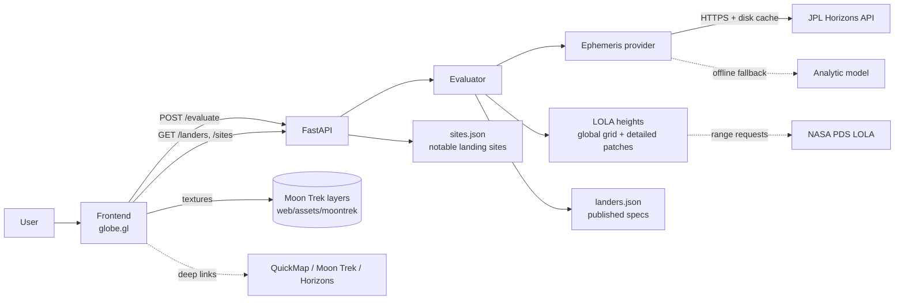

# Lunar Planner: Architecture

> Hackathon-sized. Two processes, one core endpoint.
> Items marked **(assumed)** are my picks where your description didn't say. Change them freely.

## Overview

The user picks a site, either by clicking anywhere on a 3D Moon, choosing a notable landing site (Apollo, Luna, Chang'e, past and planned CLPS) or typing coordinates. They then pick a real CLPS lander and a landing date and get a pass/fail verdict for that mission. Every site the user adds shows up in a comparison list they can swap between.

The browser owns the UI and the session state (the list of sites). The backend owns all the physics and data. Nothing is stored server-side, apart from a disk cache of Horizons responses.

It is built on the three NASA tools the challenge recommends:

| Tool | How we use it |
|---|---|
| **JPL Horizons** | The source of truth for Sun and Earth azimuth/elevation from any lunar surface point, given the site's LOLA elevation as its altitude. Also gives the sub-solar and sub-Earth points that light the globe (`api/ephemeris.py`). |
| **LRO LOLA (NASA PDS)** | Real elevation at two levels: the global LDEM_128 grid (~237 m) for every click, and ~30 m data fetched on demand around a site (`api/lola.py`). Drives site elevation and slope, the 3D terrain, and the terrain skyline that blocks the Sun and Earth. This is the same LOLA data Moon Trek and QuickMap display. |
| **Moon Trek** | Global map layers (WAC imagery, LOLA elevation, LOLA slope, Diviner max temperature), stitched from its WMTS tiles into globe textures (`scripts/fetch_moontrek_layers.py`), plus a deep link per site. |
| **QuickMap** | A deep link per site that opens LROC QuickMap zoomed to it, for high-resolution imagery and its visibility tools. |



## User flow → system mapping

| Step | UI | Backend call |
|---|---|---|
| 1. Click a spot, pick a notable site, or type lat/lon | Pop-up: Sun/Earth now and time to sunset/Earthset, sky chart, % sunlight, % Earth visible, slope, elevation, temp range, links to QuickMap / Moon Trek / Horizons | `GET /sites` (loaded once), `POST /evaluate` (site only) |
| 2. Pick lander and payload | Dropdown plus fact sheet | `GET /landers` (loaded once) |
| 3. Pick landing date | Timeline showing only valid windows, plus estimated launch date | `POST /evaluate` (site + lander) |
| 4. Summary | Pass/fail with each check explained, dates, sources | `POST /evaluate` (full) |
| 5. Lander at the site | 3D model on the globe at the site's lat/lon | None (frontend only) |
| 6. Comparison | Scorecard plus clickable list of sites | None (cached results) |

The comparison view is just the frontend's list of cached `/evaluate` results. It works from any step because it never needs the backend.

## Components

### Frontend (`web/`)
- **Stack:** plain HTML + JS, `globe.gl` from a CDN, no build step. Chart.js or hand-rolled SVG for charts **(assumed)**.
- **Globe:** Moon texture via `globeImageUrl`, switchable between the Moon Trek layers in `web/assets/moontrek/layers.json`, plus a bump map for relief on the imagery layer. Notable landing sites render as `labelsData` (gold = landed, cyan = planned). User sites render as `pointsData`. Any lat/lon is selectable via `onGlobeClick` or the coordinate form.
- **Deep links (`web/links.js`):** QuickMap (`prjExtent` in meters; `proj=16` equidistant cylindrical below ±75°, `27`/`26` south/north polar stereographic), Moon Trek (`#x=lon&y=lat&z=zoom`), and the raw Horizons az/el table for the Sun and Earth. All three projections were checked by opening a generated link and reading QuickMap's cursor coordinates.
- **Lander model (step 5):** a rough placeholder built from three.js primitives (a box body, four cylinder legs, a flat panel), colored per lander. Placed at the site with `customLayerData`. No model files to source or license. Swap in real GLBs later if there's time.
- **Pop-up:** sky chart (Sun and Earth positions over the horizon), stat tiles, **Confirm** and **Add to comparison** buttons.
- **Timeline:** a horizontal strip. Valid windows are filled, invalid dates are not selectable.
- **Visualizations:**
  - Sunlight on the panel (W/m²) over the landing window, as a line chart.
  - Earth communications access over time at that site, as a strip or area chart.
- **Analysis period (right panel, top):** one setting for the whole app: a single UTC day or a date range. Every site, including every comparison row, is evaluated over it (changing it re-evaluates them all). In single-day mode, sunlight and Earth contact show as hours out of 24. Mission pass/fail checks still use the mission window, and with a landing chosen, the 3D timelapse fetches the mission series (`/evaluate` without a period).
- **Compared sites (left panel):** a semi-transparent comparison table: one row per site, columns for verdict, sunlight (hours or %), Earth, slope, peak panel sunlight, elevation, lander/landing and terrain level, with colour-coded cells. Clicking a row makes it active and flies the globe to it. × removes it.
- **Stat colours:** site tiles and summaries are green/yellow/red (`rateStats()` in `web/app.js`), tied to the evaluator thresholds and the lander's limits. Green = passes with margin, yellow = close to the limit, red = fails or poor. Thresholds show on hover; the legend is bottom-left. Sunlight uses 18/6 h for a single day, 75/60% over a mission, 70/40% for a range under 25 days, and 45/30% for a month or more. Earth uses 95/80% (22.8/19.2 h for a day), slope 0.7×limit/limit, and peak panel sunlight 500/150 W/m². Elevation and (placeholder) temperature aren't rated.
- **3D site view (`web/site3d.js`, three.js 0.170 via the import map in `index.html`):** a 20 × 20 km terrain mesh from `/terrain/patch` (true 1× vertical scale, with the Moon's curvature applied), a directional light at the Sun's Horizons az/el with shadows, the Sun and Earth drawn 6× and 3× their true angular size so they're visible (said on screen), and Earth's phase from the Sun/Earth geometry. Also shown: the skyline from `/terrain/horizon` and N/E/S/W labels. A timelapse plays the `/evaluate` series from the landing hour to mission end (or across a lunar day if no landing is chosen), with play/pause, speed and a scrubber. The readout shows UTC time, T+, Sun and Earth az/el, sunlight on the panel (W/m²), comms, time to sunset/Earthset, and "behind terrain" when the skyline blocks the Sun or Earth. Moon and Earth surfaces are generic textures by design. Coordinates: x = east, y = up, z = −north, and direction = `(sin az·cos el, sin el, −cos az·cos el)`. `window.__lunar3d` exposes the live view for debugging. The view uses the site's terrain level (global: 257² vertices; detailed: 513²) and has its own "Get detailed terrain" button, which reopens it at the same moment. Terrain beyond the 20 km patch still casts shadows through an invisible **skyline occluder**: a ring just outside the patch, as tall as the real skyline in each direction, that only casts shadows. It's exact at the landing site and approximate elsewhere.
- **Globe lighting:** a "Light by the real Sun" toggle (on by default) points globe.gl's directional light from the Horizons sub-solar point and shows Sun/Earth markers. The time used is the chosen landing time, or now. `window.__globe` exposes the globe for debugging.
- **State:** one array of sites in memory:

```js
{ id, lat, lng, lander, payload, landingDate, result /* last /evaluate response */ }
```

Remember that globe.gl uses `lng` and the API uses `lon`.

### Backend (`api/`)
- **Stack:** FastAPI + Uvicorn, Pydantic models. FastAPI also serves `web/` as static files, so one process, one port, no CORS **(recommended)**.
- **Endpoints:** `POST /evaluate`, `GET /landers`, `GET /sites`, `POST /terrain/detail`, `GET /terrain/patch`, `GET /terrain/horizon`, `GET /sky/subpoints`, `GET /health`.
- **Elevation, two levels (`lola.py`).** Both levels are *height sources*: `heights(lat_deg, lon_deg) -> metres` above the 1737.4 km sphere (the same reference radius as Horizons), plus `source` and `resolution_m`.
  - **Global estimate:** `LolaGlobalHeights` memory-maps LOLA **LDEM_128** (128 px/deg, ~237 m, 2.1 GB; LDEM_64 also works), downloaded once by `scripts/fetch_lola.py`. Big data lives **outside the project**, in `~/LunarPlannerData/` (or `$LUNAR_DATA_DIR`, see `api/paths.py`), so it stays out of git and OneDrive. Instant for any point. If the file is missing, `main.GLOBAL_HEIGHTS` falls back to `patch.SyntheticHeights` (labelled PLACEHOLDER).
  - **Detailed (on demand):** `fetch_detail_patch()` builds a 30 × 30 km, 30 m local grid from NASA PDS using HTTP multi-range requests. Only the needed rows come down (a few MB out of 0.5–2 GB files), in 3–7 s, then it's cached in `~/LunarPlannerData/lola_detail/`. Below 76° latitude it uses LDEM_1024 cylindrical tiles (~30 m, crossing tile edges and the 0/360 seam). Above 76° it uses the LDEM_75S/75N_30M polar stereographic grids. `DetailedHeights` uses the patch within 15 km and the global grid beyond, so distant mountains still count.
  - Validation: LDEM_64 gave 2,602 m at IM-1, against NASA's published ~2,579 m. The polar and cylindrical detailed products agree (correlation 0.999, mean difference under 3 m). Detailed slope at IM-1 is 13.3° over 60 m; a published study of the landing site gives about 12°.
- **Local terrain (`patch.py`):** products built from a height source.
  - `GET /terrain/patch?lat&lon&size_km=20&n=256&level=global|detailed` → `{center_lat, center_lon, size_m, n, spacing_m, projection: "local-tangent", center_height_m, heights: [n·n, row-major, row 0 = north edge, col 0 = west edge, null = hole], source, level}`. Curvature is not removed (the client applies it).
  - `GET /terrain/horizon?lat&lon&radius_km=150&level=global|detailed` → `{azimuth_step_deg: 1, elevation_deg: [360 values, clockwise from north], radius_m, observer_height_m: 2, source, level}`. Calculated by marching 300 log-spaced samples out to the radius along each azimuth, including curvature. Takes about 0.2 s and is cached.
  - `POST /terrain/detail?lat&lon` → downloads (or reuses) the detailed patch: `{level, product, spacing_m, size_m, cached, seconds, source}`. Returns 502 with a message if NASA PDS can't be reached.
- **Sun & Earth on the globe:** `GET /sky/subpoints?time=ISO` (default now) → `{sub_solar: {lat, lon}, sub_earth: {lat, lon}, time, source}` from Horizons (`COMMAND='301'`, `CENTER='500@399'`, `QUANTITIES='14,15'`), cached per hour. The globe's directional light points from the sub-solar direction, so day and night are real. Sun and Earth markers float above both points (direction only, not to scale).
- **`evaluator.py`:** `evaluate(lat, lon, terrain=..., ephem=..., lander=..., ...) -> Result`. It does no I/O itself. The ephemeris provider is passed in, so tests use the offline one.
- **Ephemeris (`ephemeris.py`):** `HorizonsEphemeris` calls the JPL Horizons API (`CENTER='coord@301'`, `SITE_COORD='lon,lat,alt_km'` with the site's LOLA elevation (the "Horizons refinement"), `QUANTITIES='4'`) for the Sun (`10`) and Earth (`399`) in parallel, hourly. Responses are cached on disk in `data/horizons_cache/`. A first call for a new site takes about 1–2 s, and a cached call about 10 ms. If Horizons can't be reached, it falls back to `AnalyticEphemeris` and the response's `sources` says so. Set `EPHEMERIS=analytic` to force offline mode. Horizons uses the Moon's mean-Earth (ME) frame, the same frame as LOLA.
- **Notable sites (`data/sites.json`):** Apollo 11–17, Surveyor 1, Luna 9/16/17/21/24, Chang'e 3–6, Chandrayaan-3, SLIM, IM-1, Blue Ghost M1, IM-2, plus planned CLPS targets. Planned sites without published coordinates have `precision: "region"` and a `note`. Each entry cites a `source`.
- **Site stats (`terrain.py`):** elevation and slope come from the active height source. Slope is a central difference across one source pixel: ~470 m at the global level (LDEM_128), 60 m at the detailed level. Either way it's a terrain-scale slope, not a boulder-scale one. The temperature range is still a **PLACEHOLDER** grid (`scripts/build_grids.py`) until Diviner is added.
- **Landers:** `landers.json` holds published specs per CLPS lander: name, operator, mass, payload capacity, solar array area and efficiency, max slope, operating temperature range, transit time. Each entry has a `source` URL.

## How the numbers are computed

| Output | Method |
|---|---|
| Sun/Earth azimuth and elevation over time | JPL Horizons apparent az/el from the site (altitude = LOLA elevation) |
| Terrain horizon (skyline) | `horizon_profile()` over the active LOLA level, out to 150 km, with curvature |
| Sun/Earth *visible* | Elevation above the skyline at that azimuth (`sun_visible`/`earth_visible` per step). Everything below uses this. |
| Time to sunset / Earthset | First horizon crossing in the series (`events`) |
| Hours of daylight / Earth in view | `visible_hours()`: hourly samples, with the rise/set moment inside an hour interpolated linearly (a 06:40 sunrise counts 0.33 h). `sun_hours` / `earth_hours` (+ `_flat`). |
| % time in sunlight | `sun_hours / period hours`. `sunlight_pct_flat` gives the smooth-horizon value for comparison. |
| Sunlight on the panel (shown in the UI) | `w_m2 = 1361 W/m² × sin(sun_elev)` on a flat panel, per m², before efficiency; zero in terrain shadow or below the horizon. |
| Solar watts (`w`, kept for compatibility) | `w_m2 × panel_area × efficiency` (the lander's, or 1 m² at 30%). |
| Earth visibility / comms access | Fraction of timesteps with Earth above the skyline (`earth_visible_pct_flat` for comparison). The far side correctly shows zero. |
| Sunrise/sunset, Earthrise/Earthset | First visibility change in the series, so a crater rim delays "sunrise". |
| Slope, elevation | LOLA height source (global or detailed), bilinear; slope over one pixel each side |
| Temp range | Placeholder grid lookup (bilinear) |
| Valid windows | Dates where all checks below pass over the mission duration |
| Estimated launch date | `landing_date - lander.transit_days` **(assumed)** |

Default time resolution is 1 hour over one lunar day (about 29.5 days). Use vectorized NumPy so a call takes well under a second.

## `/evaluate` contract

**Request**

```json
{
  "lat": -85.2,
  "lon": 31.0,
  "lander_id": "blue-ghost",
  "payload_kg": 90,
  "landing_date": "2027-03-14"
}
```

`lander_id`, `payload_kg`, `landing_date` and `landing_time` are optional. Omitting them returns the site-only stats from step 1. Omitting only the landing date/time also returns `windows` for step 3. `landing_time` (UTC, e.g. `"2027-03-14T07:00:00Z"`, rounded down to the hour) wins over `landing_date` (which means 00:00 UTC). With either one and a lander, the `sky`/`power_w`/`comms` series start at the landing hour and span the lander's mission, which is what the 3D timelapse plays.

| Field | Type | Rules |
|---|---|---|
| `lat` | float | -90 to 90 |
| `lon` | float | -180 to 180 |
| `lander_id` | string | Must exist in `landers.json` |
| `payload_kg` | float | 0 to the lander's capacity |
| `landing_date` | date | Must fall in the ephemeris range |
| `landing_time` | datetime (UTC) | Must fall in the ephemeris range |
| `period_start` / `period_end` | date (UTC, inclusive) | The analysis period. `period_start` alone = one 24 h day; with `period_end` = a range (max 366 days). Without them: the mission (if lander + landing) or the next lunar day. |
| `terrain_level` | `"global"` (default) or `"detailed"` | `"detailed"` downloads the ~30 m patch first if needed (a few seconds) |

**Response (200)**

```json
{
  "terrain": {
    "level": "global",
    "heights_source": "NASA LRO LOLA LDEM_128 global elevation (~237 m/pixel), PDS Geosciences Node",
    "resolution_m": 236.9,
    "site_elevation_m": -1850.0,
    "skyline_max_deg": 2.4,
    "detailed_cached": false
  },
  "period": { "kind": "day", "start": "2027-03-14T00:00Z", "end": "2027-03-15T00:00Z", "hours": 24 },
  "site": {
    "sun_hours": 18.8,
    "earth_hours": 14.6,
    "sun_hours_flat": 19.3,
    "earth_hours_flat": 14.6,
    "slope_deg": 4.2,
    "slope_baseline_m": 948,
    "sunlight_pct_flat": 80.1,
    "earth_visible_pct_flat": 61.0,
    "elevation_m": -1850,
    "temp_range_k": [95, 390],
    "sunlight_pct": 78.4,
    "earth_visible_pct": 61.0
  },
  "sky": [{ "t": "2027-03-14T00:00Z", "sun_el": 3.1, "sun_az": 91.2, "earth_el": 7.5, "earth_az": 12.0, "sun_visible": true, "earth_visible": true }],
  "events": { "sunrise": null, "sunset": "2027-03-27T05:00Z", "earthrise": null, "earthset": "2027-03-20T11:00Z" },
  "power_w": [{ "t": "2027-03-14T00:00Z", "w": 142.0, "w_m2": 73.6 }],
  "comms": [{ "t": "2027-03-14T00:00Z", "visible": true }],
  "windows": [{ "start": "2027-03-10", "end": "2027-03-22", "start_time": "2027-03-10T07:00Z", "end_time": "2027-03-22T18:00Z" }],
  "launch_estimate": "2027-03-08",
  "checks": [
    { "name": "slope", "pass": true,  "detail": "4.2° is under Blue Ghost's 10° limit" },
    { "name": "temperature", "pass": true, "detail": "Within the lander's rated range" },
    { "name": "sunlight", "pass": true,  "detail": "78% sun over the mission window" },
    { "name": "comms", "pass": false, "detail": "Earth visible only 61% of the time" },
    { "name": "payload", "pass": true,  "detail": "90 kg of 150 kg capacity" }
  ],
  "pass": false,
  "sources": ["LOLA DEM (NASA PDS)", "Diviner (NASA PDS)", "https://..."]
}
```

Each `check` carries its own plain-language `detail`, which is exactly what step 4 displays. Overall `pass` is true only if every check passes. In a site-only request (no `lander_id`), `checks` is empty and `pass`, `windows` and `launch_estimate` are `null`. With a lander but no date, `checks` holds only the date-independent checks (slope, temperature, payload). Windows are searched hour by hour: every hour is a candidate touchdown, and `start_time` (the first hour that passes) is the **suggested landing time**. The thresholds (for example, minimum sun % or Earth %) are config values in `evaluator.py` **(assumed)**.

## Data flow

1. The user clicks the globe, and the frontend calls `/evaluate` with `lat`/`lon` only.
2. The pop-up renders `site`, `sky`, `power_w` and `comms`.
3. On **Confirm**, the user picks a lander (from the cached `/landers`). The frontend re-calls `/evaluate` to get `windows` and `launch_estimate`, then draws the timeline.
4. The user picks a date, the frontend calls `/evaluate` once more for the full result, and step 4's summary renders from `checks`.
5. **Add to comparison** pushes the site and its latest result into the frontend array. Clicking a list row re-renders from that cached result.

## Errors

| Case | Code | Frontend behavior |
|---|---|---|
| Bad lat/lon, payload or date | 422 | Show the field message. Keep the pin. |
| Unknown lander | 404 | Refresh the lander list. |
| Terrain data missing at that point (grid hole) | 200 with `site` fields `null` | Show "No terrain data here". Sun and Earth stats still work, since they only need the ephemeris. |
| Anything else | 500 | "Evaluation failed, try again." Log the traceback. |

No auth, queues or retries.

## Decisions

| Decision | Choice | Why |
|---|---|---|
| Frontend build | None (CDN script tag) | Zero setup, fewer demo-day failures |
| Hosting | FastAPI serves static files | One process, no CORS |
| Number of endpoints | One core (`/evaluate`) | Same function answers every step; optional fields make it progressive |
| Comparison storage | Browser memory | No accounts, no database, instant swapping |
| Terrain data | LOLA at two levels: LDEM_128 on disk (outside the project), ~30 m on demand via HTTP range requests | Real NASA elevation everywhere instantly; detail only where it's asked for, without multi-GB downloads |
| Terrain-aware visibility | Skyline from LOLA applied to every Sun/Earth number | Crater floors and rims get correct sunlight and comms (e.g. Shackleton's floor: 0% sun vs 100% on a flat horizon) |
| Ephemeris | JPL Horizons API + disk cache, analytic fallback | Recommended by the challenge and our mentor. Authoritative, no kernels to install. Cache plus fallback keep demos working offline. |
| Map layers | Moon Trek WMTS tiles stitched once into local textures | Real NASA data with no runtime dependency on Trek |
| Site context | Deep links to QuickMap and Moon Trek | Their full analysis tools, one click away, without rebuilding them |

## Testing (minimum useful)

- **Unit:** a few `pytest` cases on the evaluator with known answers:
  - A south-pole rim point should have high sun %.
  - A far-side point should have about 0% Earth visibility.
  - Slope above the lander limit should fail the slope check.
- **API:** `TestClient` tests for site-only, full-request, bad-latitude (422) and `/health`.
- **Ephemeris:** Horizons parsing, cache and offline fallback, with no network needed. `RUN_LIVE=1 python -m pytest` also calls Horizons and checks that the Sun was about 10° up at Apollo 11's landing.
- **Sites:** every entry in `sites.json` has valid coordinates, a source, and a note if it's approximate.
- **Manual before every demo:** click a pole, the far side, the antimeridian, and add three sites to compare.

## Run it

```bash
python scripts/fetch_lola.py             # once: 2.1 GB LOLA global elevation (outside the project)
python scripts/build_grids.py            # once: placeholder temperature grids
python scripts/fetch_moontrek_layers.py  # once (textures are also committed)
uvicorn api.main:app --reload
```

Then open `http://localhost:8000`.

## Out of scope (for now)

Partial Sun-disc shadowing (the Sun is treated as a point), Diviner temperatures, boulder-scale slopes, trajectory and launch-vehicle modeling, saving or sharing sessions, user accounts, real-time data.
